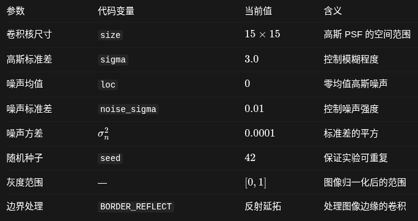

# Task 1 图像预处理与实验规划

| 分支 | Task 1 的输入与输出 | Task 2 复原 | Task 3 对照 |
|---|---|---|---|
| DIV2K | 由一张 GT 生成两种核尺寸、三种延拓方式的六组 LQ，同时保存已知 PSF | 用对应的已知 PSF 做非盲复原。固定参数比较三种边界，另用 15×15 `reflect` 单独做参数扫描 | 双三次放大展示及同尺寸重采样对照 |
| RealBlur-J | 读取一对实拍模糊图和清晰图，灰度化、归一化 | 比较四组人工指定的高斯 PSF，考察未知真实核时的近似复原效果 | 双三次插值和 NLM 去噪 |

评价环节用同一分支的 GT 汇总 LQ、频域复原和对照结果，报告 PSNR、SSIM，并观察边缘、振铃和拖尾。Radon 运动核估计属于原题选做项。[Task 4](../task4/README.md) · [Radon 选做实验](../task3_extra/README.md)

## 对于DIV2K
第一步：经过程序的运行，已经读取高清 GT 图像，并转灰度:
假设原始图像是 RGB 彩色图像，每个像素由三个通道表示：
\[
I(x,y)=(R(x,y),G(x,y),B(x,y))
\]
OpenCV 默认采用加权方式将其转换为灰度：
\[
\boxed{
f(x,y)=0.299R(x,y)+0.587G(x,y)+0.114B(x,y)
}
\]
随后进行归一化：
\[
\boxed{
f_{\mathrm{norm}}(x,y)=\frac{f(x,y)}{255}
}
\]

第二步：为了仿真生成退化 LQ 图，我们手动实现退化模型: $g(x,y)=f(x,y)*h(x,y)+\eta(x,y)$，即构建高斯 PSF（point spread function） 并在空间域与图像卷积，然后叠加噪声。

- 构造高斯点扩散函数（PSF）
在连续空间中，标准二维各向同性高斯函数为：
\[
h(x,y)=\frac{1}{2\pi\sigma^2}
\exp\left(-\frac{x^2+y^2}{2\sigma^2}\right)
\]
\(\sigma\) 是高斯分布的标准差，控制扩散程度；\(h(x,y)\) 描述一个理想点光源经过成像系统后如何扩散。

程序固定 $\sigma=3$ 像素，对比 **\(15\times15\)** 和 **\(19\times19\)** 两种离散卷积核。一维高斯在 $\pm3\sigma$ 内的概率约为 99.73%，这是选择核支撑范围的一种参考。奇数尺寸的核半径为 $r=(k-1)/2$，若要求每个坐标方向覆盖 $\pm3\sigma$，则 $k\geq6\sigma+1$。因此 $19\times19$ 覆盖到 $\pm9$ 像素，$15\times15$ 截断在 $\pm7$ 像素，两种离散核均对截断后的权重重新归一化。

以 $15\times15$ 核为例，取坐标范围
\[
x,y\in\{-7,-6,\ldots,0,\ldots,6,7\}
\]

首先计算未归一化的权重：
\[
\widetilde h(x,y)
=\exp\left(-\frac{x^2+y^2}{2\sigma^2}\right)
\]

再除以所有权重之和：
\[
\boxed{
h(x,y)=
\frac{\widetilde h(x,y)}
{\displaystyle\sum_{i=-7}^{7}\sum_{j=-7}^{7}\widetilde h(i,j)}
}
\]

此时：
\[
\sum_{x=-7}^{7}\sum_{y=-7}^{7}h(x,y)=1
\]

- 高斯卷积：产生模糊图像

\[
\boxed{
b(x,y)=
\sum_{i=-7}^{7}\sum_{j=-7}^{7}
h(i,j)f(x-i,y-j)
}
\]

这里用 \(b(x,y)\) 表示只有模糊、尚未添加噪声的图像。

- 添加高斯噪声
我们假设图像中的噪声服从正态分布：
\[
\boxed{
\eta(x,y)\overset{\mathrm{i.i.d.}}{\sim}
\mathcal N(0,\sigma_n^2)
}
\]

其中：
\[
\sigma_n=0.01,\qquad \sigma_n^2=0.0001
\]

也就是：
\[
\eta(x,y)\sim\mathcal N(0,0.0001)
\]
## 对于 RealBlur-J
读取数据集自带的实拍 LQ 与配对清晰 GT，转灰度、归一化。保留原始成对退化，供后续未知 PSF 的频域复原、对照实验与评价使用。
## 参数

每种核尺寸都使用 `zero`（零填充）、`reflect`（反射延拓）和 `wrap`（周期延拓）生成退化图。六组共用随机种子 `42` 生成的同一份噪声，叠加后将灰度裁剪至 $[0,1]$，量化为 8 位 PNG。PSF 以 `.npy` 保存，供 Task 2 和 Task 4 直接读取。比较边界时，固定核尺寸、噪声实现和复原参数，只改变退化边界。

在 `experiment2` 目录运行 `python3 task1/task1.py`，输入取自 `data/`，结果写入 `task1/output/`。六组退化图见[全图对照](output/div2k_comparison.png)，实拍图对见 [RealBlur-J 对照](output/realblur_comparison.png)。
