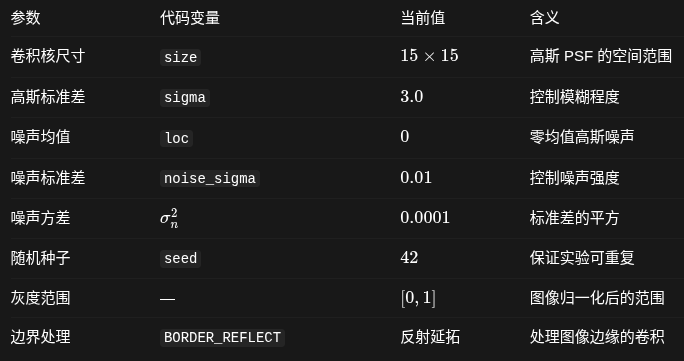

# 图像预处理
## 对于DIV2K
第一步：经过程序的运行，已经读取高清 GT 图像，并转灰度:
假设原始图像是 RGB 彩色图像，每个像素由三个通道表示：
\[
I(x,y)=(R(x,y),G(x,y),B(x,y))
\]
OpenCV 默认采用加权方式将其转换为灰度：
\[
\boxed{
f(x,y)=0.299R(x,y)+0.587G(x,y)+0.114B(x,y)
}
\]
随后进行归一化：
\[
\boxed{
f_{\mathrm{norm}}(x,y)=\frac{f(x,y)}{255}
}
\]

第二步：为了仿真生成退化 LQ 图，我们手动实现退化模型: $g(x,y)=f(x,y)*h(x,y)+\eta(x,y)$，即构建高斯 PSF（point spread function） 并在空间域与图像卷积，然后叠加噪声。

- 构造高斯点扩散函数（PSF）
在连续空间中，标准二维各向同性高斯函数为：
\[
h(x,y)=\frac{1}{2\pi\sigma^2}
\exp\left(-\frac{x^2+y^2}{2\sigma^2}\right)
\]
\(\sigma\) 是高斯分布的标准差，控制扩散程度；\(h(x,y)\) 描述一个理想点光源经过成像系统后如何扩散。

我们的程序的是一个 **\(15\times15\) 的离散卷积核**。
>这里有一个超参设置：$\sigma$ 设置为 3，因为当其为 3 时，99.73%的概率集中在 $\pm3\sigma$ 之内，是相当好的的选择。那应该怎么选择尺寸？对于奇数尺寸的卷积核：$r=\frac{k-1}{2}$，如果要求：$r\geq3\sigma$，则有：$k\geq6\sigma+1$。所以，如果我们希望较完整地保留标准差为 3 的高斯分布，\(19\times19\) 比 \(15\times15\) 更合适。但是这不是强制规定。使用 \(15\times15\) 仍然是合法且合理的高斯模糊实验。我们可以进一步探究这问题（两组实验）。

因此，设置：
\[
x,y\in\{-7,-6,\ldots,0,\ldots,6,7\}
\]

首先计算未归一化的权重：
\[
\widetilde h(x,y)
=\exp\left(-\frac{x^2+y^2}{2\sigma^2}\right)
\]

再除以所有权重之和：
\[
\boxed{
h(x,y)=
\frac{\widetilde h(x,y)}
{\displaystyle\sum_{i=-7}^{7}\sum_{j=-7}^{7}\widetilde h(i,j)}
}
\]

此时：
\[
\sum_{x=-7}^{7}\sum_{y=-7}^{7}h(x,y)=1
\]

- 高斯卷积：产生模糊图像

\[
\boxed{
b(x,y)=
\sum_{i=-7}^{7}\sum_{j=-7}^{7}
h(i,j)f(x-i,y-j)
}
\]

这里用 \(b(x,y)\) 表示只有模糊、尚未添加噪声的图像。

- 添加高斯噪声
我们假设图像中的噪声服从正态分布：
\[
\boxed{
\eta(x,y)\overset{\mathrm{i.i.d.}}{\sim}
\mathcal N(0,\sigma_n^2)
}
\]

其中：
\[
\sigma_n=0.01,\qquad \sigma_n^2=0.0001
\]

也就是：
\[
\eta(x,y)\sim\mathcal N(0,0.0001)
\]
## 对于 RealBlur-J
只需要转灰度、归一化，原理与上面的一样。
## 参数

边界处理对退化图像整体的影响通常较小，但对后续频域复原的影响可能很大，可以考虑试着分别作3组实验（零填充、周期延拓、反向延拓）。