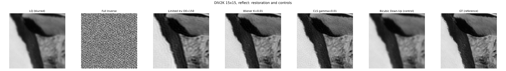
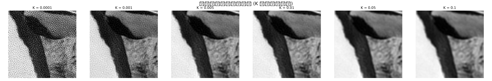
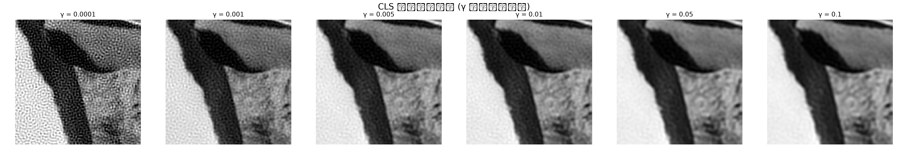
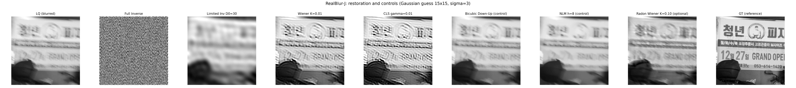

# 任务五：实验分析

## 1. 逆滤波在噪声下失效的原因与 Wiener 参数的作用

### 1.1 逆滤波为什么会放大噪声

空间不变的线性退化模型及其频域形式为

$$
g(x,y)=f(x,y)*h(x,y)+\eta(x,y),\qquad
G(u,v)=H(u,v)F(u,v)+N(u,v),
$$

其中，$f$ 为清晰图像，$g$ 为退化图像，$h$ 为点扩散函数（PSF），$\eta$ 为加性噪声。理想逆滤波在 $H\ne0$ 的频率处直接计算

$$
\widehat F=\frac{G}{H}=F+\frac{N}{H}.
$$

高斯模糊具有低通特性，许多高频分量受到强烈衰减。当 $|H|$ 很小时，除以 $H$ 会大幅放大噪声；若某频率处 $H=0$，该处的原始信息无法通过直接相除恢复。因此，即使输入噪声不强，逆滤波输出也可能被噪声主导。这是病态逆问题的表现：输入中的微小误差会引起输出的大幅变化。

本实验的全逆滤波实际使用 $G/(H+10^{-3})$，并非无修正的理想逆滤波。分母中加入小常数仍未充分限制放大效应，不能保证稳定复原。DIV2K 15×15、反射延拓组的结果如下。

| 方法 | 参数 | PSNR（dB） | SSIM |
|---|---|---:|---:|
| 原始退化图 LQ | — | 24.8606 | 0.64326 |
| 全逆滤波 | $\varepsilon=10^{-3}$ | 5.1594 | 0.00305 |
| 受限逆滤波 | $D_0=30$ | 19.4911 | 0.36749 |
| 受限逆滤波 | $D_0=150$ | 25.2432 | 0.67637 |
| 受限逆滤波 | $D_0=200$ | 22.2133 | 0.61640 |
| Wiener | $K=0.01$ | 26.8605 | 0.77884 |

全逆滤波的 PSNR 由 LQ 的 24.8606 dB 降至 5.1594 dB，局部图中出现密集黑白噪点。边界诊断表还显示，该组全逆结果在裁剪至 $[0,1]$ 前约有 99.947% 的像素越界，说明输出已严重失真；裁剪只能限制显示范围，无法恢复被破坏的图像结构。

受限逆滤波只保留截止半径 $D_0$ 内的频率。$D_0$ 太小时，有效细节被大量舍弃；适当增大 $D_0$ 可改善轮廓；继续增大则会引入更多被放大的噪声。本组在已测试的五档半径中以 $D_0=150$ 的两项指标最高，而 $D_0=200$ 时明显下降。硬截止本身也可能造成振铃，因此限制频率范围不能同时解决所有问题。

图1：全逆滤波严重失真；Wiener 和 CLS 改善了企鹅轮廓，但与 GT 相比仍缺少细羽毛纹理。数据来源：[任务四指标汇总](../task4/task4_metrics_summary.csv)、[伪影与边界诊断](../task4/task4_artifacts_diagnostics.csv)。

### 1.2 Wiener 参数如何平衡噪声与细节

在信号与噪声不相关等假设下，Wiener 滤波的频域表达式为

$$
\widehat F(u,v)=
\frac{H^*(u,v)}{|H(u,v)|^2+S_N(u,v)/S_F(u,v)}G(u,v),
$$

其中，$S_N$、$S_F$ 分别为噪声和清晰图像的功率谱。本实验用常数 $K$ 近似频率相关的比值 $S_N/S_F$：

$$
\widehat F=\frac{H^*}{|H|^2+K}G.
$$

**代码中的 $K$ 是噪声与信号功率之比，近似于信噪比的倒数。** $K$ 增大表示采用更强的噪声抑制；若用信号与噪声之比定义 SNR，其变化方向恰好相反。

当 $K$ 很小时，在 $H\ne0$ 的频率处，滤波器趋近逆滤波，对弱响应频率的补偿较强，容易放大噪声及模型误差。适当增大 $K$ 可限制增益；但 $K$ 过大也会压制有用信号，使边缘和纹理减弱，并可能降低整体亮度。因此，参数选择是在复原细节与抑制误差之间折中。

固定 DIV2K 15×15、反射延拓输入及 PSF，参数扫描结果为：

| $K$ | PSNR（dB） | SSIM |
|---:|---:|---:|
| 0.0001 | 15.0451 | 0.18176 |
| 0.001 | 23.6781 | 0.63985 |
| 0.005 | 26.6415 | 0.77292 |
| **0.01** | **26.8605** | **0.77884** |
| 0.05 | 25.3034 | 0.73943 |
| 0.1 | 23.0340 | 0.70339 |

两项指标随 $K$ 增大先升后降。在本次六档扫描中，$K=0.01$ 的两项指标最高，PSNR 相对 LQ 提高约 2.00 dB；继续增大至 0.1 时，PSNR 反而低于 LQ。这说明加强抑噪并不必然改善总体复原质量，$K=0.01$ 也只是当前样本和候选范围内的最佳设置。

图2：小 $K$ 时噪声及伪影较强，适当增大后结构更稳定，过大时细节被抑制。对应曲线见 [PSNR 曲线](../task2/param/param_fixed/1_wiener_psnr.png) 和 [SSIM 曲线](../task2/param/param_fixed/2_wiener_ssim.png)，数据见 [参数扫描表](../task2/param/param_fixed/task2_parameter_metrics.csv)。

## 2. CLS 正则项的作用及正则系数过大的影响

约束最小二乘复原（CLS）通过同时考虑数据一致性和图像平滑性，缓解直接求逆的不稳定性。本实验对应的二次正则化形式为

$$
\widehat f=\arg\min_f\left\{
\|h*f-g\|_2^2+\gamma\|p*f\|_2^2
\right\},
$$

其中，第一项要求复原图经退化模型处理后接近观测图像；第二项对图像的高频变化施加惩罚。$p$ 为拉普拉斯算子，本实验采用

$$
p=\begin{bmatrix}0&-1&0\\-1&4&-1\\0&-1&0\end{bmatrix}.
$$

在本实验的周期边界频域实现中，其解为

$$
\widehat F=\frac{H^*}{|H|^2+\gamma|P|^2}G,
$$

其中 $P$ 为拉普拉斯算子的频谱。与 Wiener 的常数 $K$ 不同，CLS 的附加项 $\gamma|P|^2$ 随频率变化，对高频通常施加更强约束，从而降低噪声引起的剧烈像素波动。

当 $\gamma$ 太小时，正则约束不足，容易出现噪声放大与振铃；适当增大可提高稳定性。但是，真实边缘和细纹理同样含有高频成分，过大的 $\gamma$ 会将其一并抑制，使边缘变软、纹理丢失，产生过度平滑。此时虽然图像看起来更平滑，却可能偏离真实结构。

同一 DIV2K 输入的 CLS 扫描结果如下。

| $\gamma$ | PSNR（dB） | SSIM |
|---:|---:|---:|
| 0.0001 | 18.0373 | 0.31062 |
| 0.001 | 23.2108 | 0.62870 |
| 0.005 | 25.7932 | 0.75102 |
| 0.01 | 26.3865 | 0.77200 |
| **0.05** | **26.8294** | **0.77795** |
| 0.1 | 26.7573 | 0.76937 |

在六档候选值中，$\gamma=0.05$ 的两项指标最高。相较于 $\gamma=0.0001$，适当增强约束显著改善了结果；从 0.05 增至 0.1 后，PSNR 下降约 0.072 dB，SSIM 下降约 0.00858，说明继续增大约束已不能带来收益。当前扫描末端只出现温和退化，不能据此声称已经实测到极强正则化下的严重过度平滑；其更一般的负面影响由上述模型解释。

图3：小 $\gamma$ 时局部噪声和振荡明显，增强正则约束后结构更稳定。对应曲线见 [PSNR 曲线](../task2/param/param_fixed/3_cls_psnr.png) 和 [SSIM 曲线](../task2/param/param_fixed/4_cls_ssim.png)，数据见 [参数扫描表](../task2/param/param_fixed/task2_parameter_metrics.csv)。

## 3. DIV2K 与 RealBlur-J 的差异及空间不变假设的适用边界

### 3.1 两组实验的结果差异

DIV2K 分支使用已知的高斯 PSF 生成退化图，固定高斯标准差 $\sigma=3$、噪声标准差 $\sigma_n=0.01$，复原时读取同一 PSF，属于非盲复原。RealBlur-J 分支直接使用实拍图，真实核未知，任务二人为指定高斯核近似它，模拟盲复原中的猜核环节；并没有完成图像和任意模糊核的联合自动估计。

为避免把参数变化混入比较，下表固定 Wiener 的 $K=0.01$、CLS 的 $\gamma=0.01$。DIV2K 使用 15×15 反射延拓组，RealBlur-J 使用 15×15、$\sigma=3$ 的假设高斯核。

| 方法 | DIV2K PSNR（dB） | DIV2K SSIM | RealBlur-J PSNR（dB） | RealBlur-J SSIM |
|---|---:|---:|---:|---:|
| LQ | 24.8606 | 0.64326 | 18.9246 | 0.57394 |
| 全逆滤波 | 5.1594 | 0.00305 | 4.7687 | 0.00270 |
| Wiener | 26.8605 | 0.77884 | 17.4861 | 0.44633 |
| CLS | 26.3865 | 0.77200 | 16.3276 | 0.36251 |

DIV2K 上，Wiener 和 CLS 均优于 LQ；RealBlur-J 上，相同算法和参数配合假设高斯核后，两项指标均低于 LQ。局部图中，DIV2K 的企鹅轮廓有所改善，而 RealBlur-J 的文字周围出现较强亮暗重影，运动拖尾仍未消除。

两组原图内容和初始退化程度不同，不能仅根据绝对 PSNR 高低判断算法优劣，应分别比较相对各自 LQ 的变化。结果支持的结论是：已知且较匹配的模型下，频域正则化复原更容易取得改善；真实图像的核失配与复杂退化会限制效果。当前数据不能将全部差异单独归因于空间变化模糊。

图4：高斯猜核的 Wiener、CLS 出现明显亮暗重影；NLM 与 Bicubic 仍保留拖尾；Radon 运动核结果有所改善，但与 GT 仍有明显差距。数据来源：[任务四指标汇总](../task4/task4_metrics_summary.csv)。

### 3.2 空间不变假设与边界条件

模型 $g=f*h+\eta$ 假定图像各处使用同一个 PSF，即同样的点源在不同位置产生形状相同的扩散。该假设适合本实验人工生成的均匀高斯模糊，也可近似描述某些全局一致的直线运动模糊。在空间变化的情形下，更一般的表达式为

$$
g(x,y)=\sum_{\xi,\zeta}h(x,y;\xi,\zeta)f(\xi,\zeta)+\eta(x,y).
$$

此时模糊响应还依赖输出位置，通常不能用单个 $H(u,v)$ 与 $F(u,v)$ 逐点相乘描述整个退化过程。真实拍摄还可能包含复杂相机轨迹、物体运动、景深差异、噪声及 JPEG 伪影。因此，单个各向同性高斯核可能既无法描述运动方向，也无法兼顾不同位置的模糊。

即使图像内部的核正确，边界假设也会影响复原。当前 FFT 实现隐含周期边界，与任务一的 wrap 退化匹配；zero 和 reflect 退化则与这一假设存在差异。

| 15×15 退化边界 | LQ PSNR（dB） | Wiener PSNR（dB） | CLS PSNR（dB） |
|---|---:|---:|---:|
| zero | 24.6041 | 26.1401 | 25.7427 |
| reflect | 24.8606 | 26.8605 | 26.3865 |
| wrap | 24.7464 | 27.3507 | 27.6414 |

固定参数时，wrap 的复原指标最高，尽管其 LQ PSNR 并非最高。诊断表中，Wiener 的边界带 PSNR 从 reflect 的 20.473 dB 提高至 wrap 的 24.754 dB，内部区域分别为 27.494 dB 和 27.497 dB，差异很小。这说明本组提升主要体现在边界匹配，而不能解释为周期延拓对所有图像和算法都更好。

[三种边界的图像对比](../task4/div2k_15x15_boundary_compare.png) · [边界诊断数据](../task4/task4_artifacts_diagnostics.csv)

### 3.3 选做实验提供的补充证据

Radon 选做实验从 RealBlur-J 图像估计约 29°、26.95 像素的直线运动核。在相同 Wiener 参数 $K=0.10$ 下，结果为：

| PSF | PSNR（dB） | SSIM |
|---|---:|---:|
| 原始 LQ | 18.9246 | 0.57394 |
| 高斯 15×15，$\sigma=3$ | 19.0753 | 0.55628 |
| 高斯 35×35，$\sigma=3$ | 19.0726 | 0.55682 |
| 高斯 35×35，$\sigma=5$ | 19.3640 | 0.55538 |
| 高斯 35×35，$\sigma=7$ | 19.5253 | 0.54080 |
| Radon 运动核 | **20.3334** | **0.60804** |

运动核在这组同参数比较中取得最高指标，支持方向性模型更适合当前样本。但它仍是全局直线运动近似，无法完整描述空间变化和复杂轨迹；同时，本次比较改变了核的模型及参数来源，不能把全部提升归因于 Radon 估计精度。$K$ 的选取参考了当前样本的 GT 指标，属于事后敏感性分析，并非无需 GT 的自动选参。

数据来源：[同参数核比较表](../task3_extra/output/gaussian_radon_comparison/all_metrics.csv)、[选做实验说明](../task3_extra/README.md)。

## 4. 核失配为什么容易产生振铃伪影

设真实退化核的频谱为 $H_t$，复原时假设的核为 $H_a$。先在空间不变近似下分析理想逆滤波：

$$
\widehat F=\frac{H_tF+N}{H_a},\qquad
\widehat F-F=
\left(\frac{H_t}{H_a}-1\right)F+\frac{N}{H_a}.
$$

即使没有噪声，只要 $H_a\ne H_t$，也可能产生第一项所描述的系统误差。假设核在某些频率处响应很小，而真实核并未同样衰减时，复原会对这些频率过度补偿；核的方向、长度或中心位置不正确，还会造成幅度或相位补偿错误。

对实际使用的 Wiener 滤波，等效的信号传递项为

$$
T(u,v)=\frac{H_a^*(u,v)H_t(u,v)}{|H_a(u,v)|^2+K}.
$$

理想情况下希望 $T$ 接近 1；核失配时，$T$ 的异常幅度与相位变化会改变图像结构。若相应的空间域响应具有正负旁瓣，强边缘附近就容易发生过冲和欠冲，表现为交替明暗条纹、光晕或重影。文字、招牌和黑白交界处灰度变化大，因此更容易观察到这些现象。核失配提高了出现伪影的风险，但并非任何失配都必然形成明显振铃。

图4中，高斯猜核的 Wiener 和 CLS 在文字笔画附近产生明显亮暗重影，结果与上述机制一致。但伪影也可能受到噪声、边界不连续及滤波器设计影响，不能仅凭振铃确定是哪一种误差。特别是受限逆滤波的频域硬截止，即使核正确，也可能因其振荡的空间域响应引起振铃。

增大 $K$ 或 $\gamma$ 能限制部分异常增益，却不能纠正错误的退化模型。改用更合适的运动核、保证 PSF 中心与 FFT 原点对齐、改善边界处理，均有助于减轻相关伪影；对于空间变化模糊，还需要考虑局部模型。上述方法属于机制上的改进方向，当前实验未逐一验证其独立效果。

## 5. 图像复原与插值放大的根本区别

图像复原以退化模型为依据，利用 PSF、噪声假设或正则约束，从观测图像估计清晰图像。本实验的 Wiener 和 CLS 均属于此类方法，输出尺寸可以保持不变。

双三次插值根据邻域采样值估计新采样位置的灰度，主要改变像素网格和图像尺寸。本实验调用的 `INTER_CUBIC` 不使用 PSF，也不求解去模糊逆问题，因此不能凭增加像素数量恢复已经衰减或丢失的真实细节。放大后轮廓可能更连续，但原有拖尾仍会保留。

| 比较内容 | 本实验的图像复原 | 双三次插值放大 |
|---|---|---|
| 主要目标 | 估计清晰图像，减轻退化 | 在更密的网格上估计像素值 |
| 主要依据 | 退化模型、PSF、噪声或先验约束 | 邻域像素与插值核 |
| 是否显式反演模糊 | 是 | 否 |
| 输出尺寸 | 可与输入相同 | 本实验直接放大为原来的 2 倍 |
| 主要风险 | 噪声放大、核失配、振铃、过度平滑 | 模糊保留、细节缺失，也可能出现插值过冲 |

直接 2 倍放大后的图像与原始 GT 尺寸不同，本实验仅作视觉展示，没有直接计算二者的 PSNR、SSIM。为获得同尺寸的辅助对照，任务三另做 Down-Up：先用 `INTER_AREA` 缩小至一半，再用 `INTER_CUBIC` 恢复到原尺寸。

| 分支与方法 | PSNR（dB） | SSIM |
|---|---:|---:|
| DIV2K 15×15 reflect：LQ | 24.8606 | 0.64326 |
| DIV2K：Bicubic Down-Up | 24.9394 | 0.66143 |
| DIV2K：Wiener，$K=0.01$ | 26.8605 | 0.77884 |
| RealBlur-J：LQ | 18.9246 | 0.57394 |
| RealBlur-J：Bicubic Down-Up | 18.9500 | 0.57565 |
| RealBlur-J：NLM，$h=8$ | 18.9469 | 0.58211 |

Down-Up 相对 LQ 的 PSNR 分别仅提高约 0.079 dB 和 0.025 dB。该过程包含额外的降采样和平滑，可能降低部分噪声、改变像素误差，同时损失细节。因此，这些小幅指标提升不能作为插值能够去模糊的证据，也不能与直接 2 倍放大混为一谈。

NLM 则利用相似图像块进行加权平均，主要用于抑制噪声。RealBlur-J 上，$h=8$ 时 PSNR 比 LQ 提高约 0.022 dB，SSIM 提高约 0.00817，图4中文字拖尾仍明显，说明去噪本身不足以消除运动模糊。

数据来源：[任务四指标汇总](../task4/task4_metrics_summary.csv)、[任务三对照方法说明](../task3/README.md)。

## 6. 结论与实验范围

本实验表明，直接逆滤波对被模糊严重衰减的频率进行补偿时会放大噪声；Wiener 与 CLS 通过限制补偿强度提高稳定性，但参数过大会抑制有效细节。在已知 PSF 的 DIV2K 上，合理参数取得了明显改善；在 RealBlur-J 上，简单高斯猜核与真实退化不匹配，固定主实验参数的复原结果反而低于输入。选做运动核实验说明，改善核的描述并配合适当正则化，可以提升当前真实样本的结果，但仍不能完整解决复杂真实模糊。

本次必做比较基于一张 DIV2K 图像和一对 RealBlur-J 图像；参数最佳值仅针对已测试样本及候选范围。当前结果同时受到核模型、正则参数、噪声、边界与量化处理影响，未对这些因素进行完全独立的因果分离。所有同尺寸汇总采用任务四口径：归一化灰度、`data_range=1.0`，频域复原图裁剪后在浮点域评价，Bicubic 与 NLM 按其 8 位处理结果评价。图件是量化后的展示图，重新从 PNG 计算指标可能存在细小差异。

复原、插值和去噪的目标与依据不同，应结合退化模型、PSNR/SSIM 以及边缘、纹理和拖尾的实际变化解释结果，不能仅以像素数量或单项指标判断是否恢复了真实细节。

